<!-- GLITCH // perfil. SVGs gerados por scripts/build.py; telemetria e snake pelo workflow. -->

<picture>
  <source media="(prefers-color-scheme: light)" srcset="assets/banner-paper.svg"/>
  
</picture>

 

<picture>
  <source media="(prefers-color-scheme: light)" srcset="assets/head-sobre-paper.svg"/>
  
</picture>

Desenvolvedor full-stack em Chapecó/SC e bacharelando em Ciência da Computação na **Unochapecó**. CEO da **Type77 — Consultoria e Desenvolvimento** e sócio-proprietário da **ZROOT**. Projeto e entrego sistemas completos para negócios reais: controle de acesso, estoque, atendimento, dashboards e automação com hardware.

<picture>
  <source media="(prefers-color-scheme: light)" srcset="assets/whoami-paper.svg"/>
  
</picture>

  

<picture>
  <source media="(prefers-color-scheme: light)" srcset="assets/head-stack-paper.svg"/>
  
</picture>

<picture>
  <source media="(prefers-color-scheme: light)" srcset="assets/stack-paper.svg"/>
  
</picture>

  

<picture>
  <source media="(prefers-color-scheme: light)" srcset="assets/head-projetos-paper.svg"/>
  
</picture>

<table>
<tr>
<td><a href="https://github.com/dopa-do-terere/WMS-Inviolavel">
<picture>
  <source media="(prefers-color-scheme: light)" srcset="assets/card-wms-paper.svg"/>
  
</picture>
</a></td>
<td><a href="https://github.com/dopa-do-terere/TIDESK">
<picture>
  <source media="(prefers-color-scheme: light)" srcset="assets/card-tidesk-paper.svg"/>
  
</picture>
</a></td>
</tr>
<tr>
<td><a href="https://github.com/dopa-do-terere/zControl">
<picture>
  <source media="(prefers-color-scheme: light)" srcset="assets/card-zcontrol-paper.svg"/>
  
</picture>
</a></td>
<td><a href="https://github.com/dopa-do-terere/InvioKey">
<picture>
  <source media="(prefers-color-scheme: light)" srcset="assets/card-inviokey-paper.svg"/>
  
</picture>
</a></td>
</tr>
<tr>
<td><a href="https://github.com/dopa-do-terere/InvioInstall">
<picture>
  <source media="(prefers-color-scheme: light)" srcset="assets/card-inviinstall-paper.svg"/>
  
</picture>
</a></td>
<td><a href="https://github.com/dopa-do-terere/ZIQ">
<picture>
  <source media="(prefers-color-scheme: light)" srcset="assets/card-ziq-paper.svg"/>
  
</picture>
</a></td>
</tr>
<tr>
<td><a href="https://github.com/dopa-do-terere/zapy_rasp">
<picture>
  <source media="(prefers-color-scheme: light)" srcset="assets/card-zapy-paper.svg"/>
  
</picture>
</a></td>
<td><a href="https://github.com/dopa-do-terere/DotOne-Dash">
<picture>
  <source media="(prefers-color-scheme: light)" srcset="assets/card-flesak-paper.svg"/>
  
</picture>
</a></td>
</tr>
</table>

> `!` A maior parte do que a Type77 e a ZROOT entregam é privada, sob contrato com clientes. O que está aqui é a vitrine pública.

 

<picture>
  <source media="(prefers-color-scheme: light)" srcset="assets/head-telemetria-paper.svg"/>
  
</picture>

<picture>
  <source media="(prefers-color-scheme: light)" srcset="https://raw.githubusercontent.com/dopa-do-terere/dopa-do-terere/output/telemetry-paper.svg"/>
  
</picture>

  

<picture>
  <source media="(prefers-color-scheme: light)" srcset="https://raw.githubusercontent.com/dopa-do-terere/dopa-do-terere/output/github-contribution-grid-snake.svg"/>
  
</picture>

  

<picture>
  <source media="(prefers-color-scheme: light)" srcset="assets/head-contato-paper.svg"/>
  
</picture>

Projeto em mente, um sistema para tirar do papel ou só uma ideia sobre tecnologia: o canal está aberto.

<a href="https://www.linkedin.com/in/bernardo-rodrigues-dev/"><picture>
  <source media="(prefers-color-scheme: light)" srcset="assets/btn-linkedin-paper.svg"/>
  
</picture></a>
<a href="https://twitter.com/Benrdrs"><picture>
  <source media="(prefers-color-scheme: light)" srcset="assets/btn-x-paper.svg"/>
  
</picture></a>

 

<picture>
  <source media="(prefers-color-scheme: light)" srcset="assets/footer-paper.svg"/>
  
</picture>

Fontes Silkscreen, JetBrains Mono e Geist (SIL OFL 1.1) · <a href="scripts/fonts/README.md">créditos</a>

